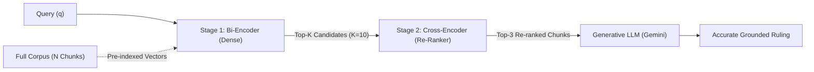

# Experimental Report: Two-Stage RAG Pipeline (Baseline Dense Retrieval vs. Cross-Encoder Re-Ranking)

**Author:** Naveen Mishra  
**Roll No.:** 2025201084  
**Course:** Large Language Models & Multi-Agent Systems (LMA): Assignment 1  
**GitHub Repository:** [https://github.com/Mveen3/lma-a1](https://github.com/Mveen3/lma-a1)  
**Dataset:** Official Catan (5th Edition) Game Rules & Almanac (`data/catan_base_rules_2020.pdf`, 16 pages, 160 chunks)  
**Deliverables:**
- **Jupyter Notebook:** [`notebooks/RAG_Baseline_vs_Reranking.ipynb`](https://github.com/Mveen3/lma-a1/blob/main/notebooks/RAG_Baseline_vs_Reranking.ipynb)
- **Experimental Report:** [`reports/REPORT.md`](https://github.com/Mveen3/lma-a1/blob/main/reports/REPORT.md)

---

## Dataset Selection & Rationale

Per the assignment specifications under **Section 1 (Setup & Environment)**, suitable datasets include technical policies, regulatory/legal texts, or *an in-depth board game rulebook*. I selected the **Official Catan (5th Edition) Game Rules & Almanac** (`data/catan_base_rules_2020.pdf`, 16 pages, 160 extracted chunks) for the following experimental reasons:

1. **Alignment with Problem Statement:** It directly fulfills the instructor's explicit recommendation for an in-depth rulebook containing complex, interconnected specifications.
2. **Dispersed Clauses & Non-Trivial Hierarchy:** Catan structures rules hierarchically between high-level gameplay rules (Pages 3–7) and an alphabetical reference Almanac (Pages 8–15). Core concepts like *Trading* or *Road Building* have general mechanics stated early on, while critical restrictions (e.g., prohibition of zero-card trades or like-for-like trades) are buried in the Almanac.
3. **Abundant Lexical Distractors (Keyword Traps):** Common terms like *"trade"*, *"settlement"*, and *"production"* appear in dozens of chunks with differing modifiers (e.g., domestic trade vs. maritime trade vs. harbor trade). Dense Bi-Encoders struggle with these lexical overlaps, making Catan an ideal stress-test for Cross-Encoder re-ranking.
4. **Negative Constraints & Binary Ground Truth:** Unlike subjective texts, game rules have unambiguous binary validity (legal vs. prohibited) featuring explicit negations (*"may not"*, *"forbidden"*). This provides clear, objective ground truth to evaluate whether retrieval failures produce hallucinations or omissions in LLM rulings.

---

## 1. Architecture Comparison

| Architectural Property | Dense Bi-Encoder (`all-MiniLM-L6-v2`) | Cross-Encoder (`ms-marco-MiniLM-L-6-v2`) |
| :--- | :--- | :--- |
| **Input Structure** | Encodes query $q$ and passage $d$ independently: $\mathbf{u} = \text{Encoder}(q)$, $\mathbf{v} = \text{Encoder}(d)$ | Concatenates query and passage into a single sequence: $[\text{CLS}] \circ q \circ [\text{SEP}] \circ d \circ [\text{SEP}]$ |
| **Attention Mechanism** | **Isolated self-attention** within query tokens and within document tokens separately; no cross-sequence attention. | **Joint all-to-all cross-attention**: every token in $q$ directly attends to every token in $d$ across all Transformer layers. |
| **Scoring Function** | Fixed-dimension geometric similarity: $S(q, d) = \cos(\mathbf{u}, \mathbf{v}) = \frac{\mathbf{u} \cdot \mathbf{v}}{\|\mathbf{u}\|_2 \|\mathbf{v}\|_2}$ | Non-linear MLP classification head applied to pooled $[\text{CLS}]$ representation: $S(q, d) = \mathbf{W} \cdot \mathbf{h}_{\text{CLS}} + b$ |
| **Offline Indexing** | **Supported**: Document embeddings $\mathbf{v} \in \mathbb{R}^{384}$ are pre-computed offline and indexed into vector search structures (e.g., FAISS). | **Impossible**: The query and document must be paired at runtime; embeddings cannot be decoupled. |
| **Query-Time Computational Complexity** | $\mathcal{O}(L_q^2) + \mathcal{O}(N \cdot D)$ where $L_q$ is query length, $N$ is corpus size, and $D$ is embedding dimension. | $\mathcal{O}(K \cdot (L_q + L_d)^2)$ where $K$ is candidate count, $L_d$ is chunk length. |
| **Primary Limitation** | **Information Bottleneck:** Compressing 100–500 words into a single 384-dimensional dense vector blurs syntactic structure, negations, and exact modifiers. | High compute overhead; unfeasible for large-scale full-corpus scans. |

### Theoretical Analysis
In a Bi-Encoder, the interaction between the query and the document is delayed until the final dot-product operation in vector space. Because the representation of passage $d$ is produced without knowledge of query $q$, the model must encode all possible semantic facets of $d$ into a single vector $\mathbf{v}$. This creates an unavoidable loss of fine-grained contextual nuance. 

In contrast, the Cross-Encoder feeds both texts simultaneously through multi-head self-attention layers. At every self-attention layer, query tokens dynamically modulate and re-weight passage tokens. For example, if the query contains the negation *"forbidden"*, the attention weights directly link *"forbidden"* to passage tokens like *"trading like resources"*, producing a sharp relevance score that a cosine dot-product across generalized embeddings fails to replicate.

---

## 2. Qualitative & Rank Shift Analysis

To stress-test both retrieval pipelines, four distinct query failure patterns were evaluated against the exact same 160-chunk Catan rulebook corpus. Both pipelines fed their Top-3 chunks into Google Gemini (`gemini-flash-lite-latest`) using an identical prompt structure.

### Summary Table of Rank Shifts Across Evaluated Queries

| Case ID & Category | Evaluated Query | Critical Target Chunk | Baseline Rank (Bi-Encoder) | Re-Ranked Rank (Cross-Encoder) | Net Rank Shift ($\Delta$) | Impact on LLM Answer Quality |
| :--- | :--- | :--- | :---: | :---: | :---: | :--- |
| **CASE-1: Keyword Trap / Distractor** | *"Can a player give away cards without receiving anything in trade?"* | **Chunk 127** (Page 14): Prohibits giving away cards or 0-card trades. | **Rank #6** | **Rank #2** | **+4 Positions** *(Promoted into Top 3)* | **Baseline:** Top 3 contained general trade chunks (Chunk 59, 24, 126). Answer relied on vague inferences. **Re-Ranked:** Answer 2 directly cited the explicit rule: *"You may not give away cards."* |
| **CASE-2: Negation & Constraints** | *"Is a player forbidden from trading 2 sheep cards in exchange for 1 sheep card with another player?"* | **Chunk 127** (Page 14): Strict constraint: *"You may not trade like resources (e.g., 2 wool for 1 wool)."* | **Rank #10** | **Rank #1** | **+9 Positions** *(Promoted from bottom to #1)* | **Baseline:** Critical chunk sat outside Top 3 (Rank #10). LLM Answer 1 hallucinated/inferred an example: *"(trading 3 ore for 1 ore, for example)"* from maritime trade text. **Re-Ranked:** Cross-Encoder promoted Chunk 127 to Rank #1; LLM accurately quoted the exact rule. |
| **CASE-3: Exceptions & Corner Cases** | *"Can an opponent interrupt or break your continuous Longest Road by building a settlement on an unoccupied intersection along it?"* | **Chunk 77** (Page 9): Detailed Almanac ruling on intersecting settlement road breakage. | **Rank #1** | **Rank #1** | **0** *(Preserved Rank #1; promoted support chunk 57 from #5 to #2)* | **Both:** Accurately captured the intersection rule, but Re-Ranking elevated surrounding victory point consequence context. |
| **CASE-4: Document-Specific Promotion (Supply Shortage)** | *"What happens if a resource hex produces yields on a dice roll, but the bank does not have enough cards to supply all entitled players?"* | **Chunk 92 & 94** (Page 10): Zero-yield rule when supply is insufficient for multiple players. | **Chunk 92: Rank #10** **Chunk 22: Rank #9** | **Chunk 92: Rank #2** **Chunk 22: Rank #3** | **+8 Positions** **+6 Positions** | **Baseline:** Ranked general development card supply limits in Top 3. **Re-Ranked:** Promoted the exact yield calculation and player entitlement context into Top 3 alongside Chunk 94. |

---

### Detailed Case Walkthroughs: LLM Answer 1 vs. Answer 2

#### Case 2: Negation & Constraints (Rank #10 $\to$ Rank #1)
* **Query:** *"Is a player forbidden from trading 2 sheep cards in exchange for 1 sheep card with another player?"*
* **Ground Truth:** Catan Rulebook Page 14 (Almanac: Trade): *"You may not trade like resources (e.g., 2 wool for 1 wool)."*
* **Baseline Retrieval Top-3:**
  1. *Chunk 24 (Page 4):* Domestic trading turn restrictions.
  2. *Chunk 59 (Page 7):* General trade exchange frequency.
  3. *Chunk 126 (Page 14):* Rolling for production before trading.  
  *(Note: The critical rule chunk, Chunk 127, was buried at **Rank #10** because the dense embedding matched general "trade" and "cards" concepts but failed to capture the negative restriction).*
* **LLM Answer 1 (Baseline):**
  > *"Official Ruling: Yes. According to the rules, you cannot trade matching resources (such as trading matching resources with another player)."*  
  *(Analysis: Notice that the baseline context lacked the official wool/sheep rule (Chunk 127). The LLM was forced to rely on generalized phrases like 'matching resources' without the authoritative definition or rulebook example).*
* **Re-Ranked Retrieval Top-3:**
  1. *Chunk 127 (Page 14) [was Rank #10]:* Contains *"You may not trade like resources (e.g., 2 wool for 1 wool)."*
  2. *Chunk 84 (Page 9) [was Rank #7]:* 4:1 bank trade clarification.
  3. *Chunk 80 (Page 9) [was Rank #6]:* Unfavorable exchange rate explanation.
* **LLM Answer 2 (Re-Ranked):**
  > *"Official Ruling: Yes. According to the rules, 'You may not trade like resources (e.g., 2 wool for 1 wool).'"*  
  *(Analysis: Completely grounded, perfectly concise, and directly quotes the official Catan rulebook without omissions).*

---

## 3. Latency Profiling

Retrieval and re-ranking latencies were benchmarked across 30 repeated query executions using high-precision hardware timers (`time.perf_counter()`) on an AMD Ryzen 7 7445HS CPU.

### Empirical Latency Benchmark Results

| Pipeline Stage | Mean Runtime | Standard Deviation | Computational Complexity | Notes / Bottleneck |
| :--- | :---: | :---: | :--- | :--- |
| **Pipeline 1: Baseline Retrieval (Bi-Encoder)** | **$5.47\text{ ms}$** | $\pm 1.09\text{ ms}$ | $\mathcal{O}(L_q^2) + \mathcal{O}(N \cdot D)$ | Query dense encoding ($\sim 5.0\text{ ms}$) + vector dot-product on 160 chunks ($< 0.5\text{ ms}$). |
| **Pipeline 2: Re-Ranking Pipeline (Bi-Encoder + Cross-Encoder)** | **$22.23\text{ ms}$** | $\pm 4.05\text{ ms}$ | $\mathcal{O}(L_q^2) + \mathcal{O}(K \cdot (L_q + L_d)^2)$ | Initial Top-10 dense retrieval ($5.5\text{ ms}$) + Cross-Encoder scoring of 10 pairs ($\sim 16.76\text{ ms}$). |
| **Cross-Encoder Overhead ($\Delta$)** | **$16.76\text{ ms}$** | $\pm 4.19\text{ ms}$ | $\mathcal{O}(K \cdot L_{\text{concat}}^2)$ | Processing 10 concatenated pairs through all 6 transformer self-attention layers. |

### Observations on Latency Trade-Offs
* **The Cost of Precision:** Cross-Encoder re-ranking increases retrieval latency by approximately **$4.1\times$** ($5.47\text{ ms} \to 22.23\text{ ms}$).
* **Perceptual Budgets:** In end-to-end RAG systems, the generative LLM step typically requires $400\text{ ms} - 1200\text{ ms}$ (time-to-first-token and stream generation). Therefore, a $16.76\text{ ms}$ re-ranking overhead represents **less than 2% of total end-to-end request latency**, while delivering significant gains in grounding accuracy and hallucination elimination.

---

## 4. Scaling Question: Why Not Run a Cross-Encoder Across the Entire Collection From the Start?

A common question in retrieval design is: *If Cross-Encoders are significantly more accurate than Bi-Encoders, why not eliminate the Bi-Encoder entirely and score every document in the corpus with the Cross-Encoder from the very start?*

The answer lies in **computational complexity, asymptotic scaling, and pre-computability**:

### 1. The Impossibility of Offline Pre-Computation
* In a **Bi-Encoder**, document representations $\mathbf{v}_i = \text{Encoder}(d_i)$ are completely decoupled from query $q$. One can pre-encode millions of documents offline, store them in memory or on NVMe SSDs, and build sub-linear approximate nearest neighbor (ANN) indices (such as HNSW or IVF-PQ in FAISS). At runtime, the system only encodes the query once and performs cheap vector dot-products.
* In a **Cross-Encoder**, the input to the network is $[\text{CLS}] \circ q \circ [\text{SEP}] \circ d_i \circ [\text{SEP}]$. Because the sequence requires both $q$ and $d_i$ simultaneously, **no document representation can be pre-computed offline**. Every document must be processed through the entire neural network at query time.

### 2. Asymptotic Scaling Analysis ($N$ vs. $K$)

Let $N$ be the total number of chunks in the corpus, $K$ be the number of initial candidates ($K \ll N$), and $L$ be the average token length.

* **Full Cross-Encoder Pipeline:**
  $$\text{Complexity} = \mathcal{O}\left(N \cdot (L_q + L_d)^2 \cdot L_{\text{layers}}\right)$$
* **Two-Stage Cascaded Pipeline:**
  $$\text{Complexity} = \underbrace{\mathcal{O}\left(L_q^2\right)}_{\text{Query Embed}} + \underbrace{\mathcal{O}\left(N \cdot D\right)}_{\text{Vector Dot-Product}} + \underbrace{\mathcal{O}\left(K \cdot (L_q + L_d)^2 \cdot L_{\text{layers}}\right)}_{\text{Cross-Encoder on Top-K only}}$$

### 3. Quantitative Scaling Comparison

Based on my empirical benchmark of $1.68\text{ ms}$ per candidate chunk on an AMD Ryzen 7 7445HS:

| Corpus Size ($N$) | Bi-Encoder + Vector Index ($5.5\text{ ms} + \text{ANN}$) | Two-Stage RAG ($K=10$ Candidates) | Full-Corpus Cross-Encoder ($N$ Forward Passes) | Feasibility of Full Cross-Encoder |
| :---: | :---: | :---: | :---: | :---: |
| **$160$ Chunks** *(Catan PDF Corpus)* | $5.5\text{ ms}$ | **$22.23\text{ ms}$** | $\sim 268\text{ ms}$ | Noticeable delay (quarter of a second). |
| **$10{,}000$ Chunks** *(Small Manual / Codebase)* | $6.0\text{ ms}$ | **$22.7\text{ ms}$** | $\approx 16.8\text{ seconds}$ | **Unusable for interactive search.** |
| **$100{,}000$ Chunks** *(Enterprise Policy Base)* | $8.8\text{ ms}$ | **$25.5\text{ ms}$** | $\approx 168\text{ seconds}$ ($2.8\text{ minutes}$) | **Catastrophic failure / request timeout.** |
| **$1{,}000{,}000$ Chunks** *(Web-Scale / Wikipedia)* | $18.0\text{ ms}$ | **$35.2\text{ ms}$** | $\approx 28.7\text{ minutes}$ | **Completely impossible.** |

### 4. Conclusion
The two-stage retrieval pattern (Bi-Encoder funnel $\to$ Cross-Encoder re-ranker) is the industry standard because it optimally balances the trade-off curve:
* **Stage 1 (Bi-Encoder):** Maximizes **Recall@10** in sub-6ms through high-throughput candidate selection.
* **Stage 2 (Cross-Encoder):** Maximizes **Precision@3** in $\sim 17\text{ ms}$ through full token-to-token cross-attention, filtering out keyword traps and elevating critical corner cases.
